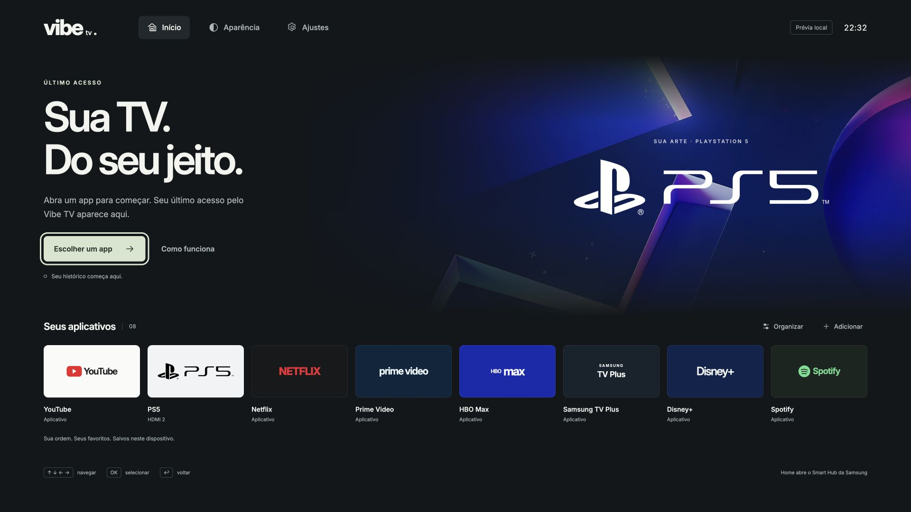

# Vibe TV

Um hub pessoal de TV, com seus aplicativos, seu PS5 e suas cores.

Fork de [simbasjungles/free-my-tv](https://github.com/simbasjungles/free-my-tv), com o histórico e a licença MIT preservados. O projeto original é Android; esta adaptação é um **aplicativo Web Tizen separado** para estudo na Samsung AU8000, com prévia local.

**Estado: fase local implementada, testada e publicada em `agent/vibe-tv`. Não instalado nem validado na TV.** O Smart Hub original não é substituído. O backup integral do sistema e dos logins ainda não foi obtido; a instalação está bloqueada por esse requisito.



## Rodar localmente

Node.js 22 ou superior e `zip`/`unzip` para o pacote. Sem `npm install`.

```sh
node --test tests/*.test.cjs
node tools/preview.cjs
```

Abra [a prévia local](http://127.0.0.1:4173). Use mouse ou setas, Enter e Escape/Voltar. O servidor escuta somente no próprio computador; não se conecta à TV.

A prévia permite verificar aparência, foco, temas e organização. Abertura de aplicativos e troca de HDMI retornam indisponibilidade no navegador. Ela não simula uma sessão real ou inventa histórico de reprodução.

## Interface

- Destaque para o último aplicativo aberto com sucesso **pelo Vibe TV**; primeiro uso sem histórico fictício.
- Ordem inicial: YouTube, PS5, Netflix, Prime Video, HBO Max, Samsung TV Plus, Disney+ e Spotify.
- Favoritos editáveis e persistentes; apps adicionais dependem do inventário real da TV.
- PS5 associado ao HDMI 2, com logo e fundo fornecidos pelo proprietário.
- Temas escuro, claro, cinza, pastel e vinho; navegação por controle e redução de movimento.
- Configurações nativas permanecem acessíveis pelo controle Samsung/Smart Hub.

O histórico privado de Netflix, Prime e demais serviços não está disponível para esta aplicação. Não há retomada de episódio, progresso ou arte de conteúdo assistido inventados. A integração atual abre o app existente quando a plataforma a permite.

## Pacote Tizen

```sh
node tools/package-tizen.cjs
```

Produz `dist/VibeTV-unsigned.wgt`: arquivo de fontes não assinado, não um pacote pronto para instalar. O comando não instala SDK, não cria certificados e não conecta a nenhum dispositivo. Assinatura e teste físico são uma etapa posterior, condicionada ao backup e às autorizações necessárias.

O código em `app/` e `build.sh` pertence ao projeto Android original. **Não use suas instruções ADB nesta Samsung Tizen.** Consulte [o README original](README.upstream.md) apenas para a plataforma correspondente.

## Evidência e continuidade

- [Limites de integração e validação física](docs/vibe-tv/compatibility.md)
- [Backup e recuperação: situação real](docs/vibe-tv/recovery.md)
- [Resultados de validação](docs/vibe-tv/validation.md)
- [Spec viva](specs/001-vibe-tv-tizen/spec.md) · [Tarefas](specs/001-vibe-tv-tizen/tasks.md)
- [Handoff](outputs/HANDOFF.md)

A tecla Home e a inicialização do Smart Hub continuam pertencendo à Samsung. A opção do sistema “Executar último aplicativo automaticamente”, quando disponível, não torna o Vibe TV o launcher obrigatório. Um app que acabou de ser usado pode ser escolhido pelo sistema no próximo início.

## Origem e licenças

Código original sob [MIT](LICENSE), de Free My TV. Os novos arquivos desta adaptação seguem a mesma licença. A fonte e os assets herdados conservam suas licenças; as duas imagens PS5 fornecidas pelo usuário não são relicenciadas por este projeto. Consulte `tizen/assets/ATTRIBUTION.txt`. Marcas e nomes pertencem aos respectivos titulares; este projeto não é afiliado à Samsung, Sony ou aos serviços de streaming.
