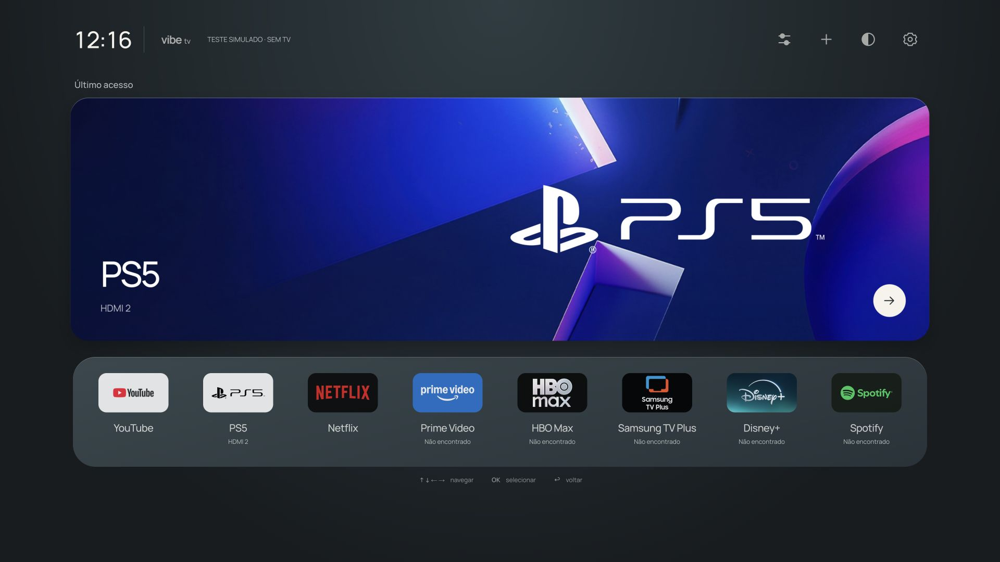

# Vibe TV

Um hub pessoal de TV, com seus aplicativos, seu PS5 e suas cores.

Fork de [simbasjungles/free-my-tv](https://github.com/simbasjungles/free-my-tv), com o histórico e a licença MIT preservados. O projeto original é Android; esta adaptação é um **aplicativo Web Tizen separado** para estudo na Samsung AU8000, com prévia local.

**Estado: versão 1.1.2 assinada, instalada e iniciada na Samsung AU8000.** A apresentação mantém o cartão grande, favoritos, artes PS5 e cinco temas. A legenda inferior foi removida; a lista de aplicativos é consultada automaticamente na abertura e no retorno, mantendo apps já identificados disponíveis durante a consulta. Os 60 testes da aplicação passaram.

O método não oficial de Home usa um helper separado, exclusivo desta TV/firmware. O Home curto já está configurado para Vibe; backup de roteamento, aplicação, restauração e reaplicação passaram no aparelho. O proprietário confirmou YouTube → Home curto → Vibe; a resposta percebida da otimização 1.1.1 ainda aguarda confirmação. Evidências e reversão em [Home nativo](docs/vibe-tv/cleanframe-home.md). Nenhum resultado de navegador substitui o teste físico do Home, do HDMI-CEC ou do boot.

O proprietário já confirmou artes, navegação e abertura nativa do YouTube nas versões anteriores. O histórico de episódios permanece dentro dos apps; o Vibe registra apenas suas próprias aberturas bem-sucedidas.



## Rodar localmente

Node.js 22 ou superior e `zip`/`unzip` para o pacote. Sem `npm install`.

```sh
node --test tests/*.test.cjs
node tools/preview.cjs
```

Abra [a prévia local](http://127.0.0.1:4173). Use mouse ou setas, Enter e Escape/Voltar. O servidor escuta somente no próprio computador; não se conecta à TV.

A prévia permite verificar aparência, foco, temas e organização. Abertura de aplicativos e troca de HDMI retornam indisponibilidade no navegador. Ela não simula uma sessão real ou inventa histórico de reprodução.

## Interface

- Cartão retangular inteiro para reabrir o último aplicativo usado **pelo Vibe TV**. Antes disso, o primeiro favorito aparece como “Acesso rápido”.
- Artes oficiais locais para as sete marcas iniciais, sem distorção; apps adicionais usam o ícone nativo quando disponível. Sem logos imitados por texto/CSS.
- Ordem inicial: YouTube, PS5, Netflix, Prime Video, HBO Max, Samsung TV Plus, Disney+ e Spotify.
- Favoritos editáveis e persistentes; apps adicionais dependem do inventário real da TV.
- PS5 associado ao HDMI 2, com logo e fundo fornecidos pelo proprietário.
- Temas escuro, claro, cinza, pastel e vinho; navegação por controle e redução de movimento.
- Controles de organização e ajustes no topo direito; ↓ do cartão vai direto aos apps, com destaque suave de 150 ms no item. Sem legenda de teclas no rodapé.
- Consulta automática dos aplicativos ao abrir/voltar ao hub. Não depende de clicar em atualizar; a opção manual em Adicionar continua disponível como alternativa.
- Configurações nativas permanecem acessíveis pelo controle Samsung/Smart Hub.

O histórico privado de Netflix, Prime e demais serviços não está disponível para esta aplicação. Não há retomada de episódio, progresso ou arte de conteúdo assistido inventados. A integração atual abre o app existente quando a plataforma a permite.

## Pacote Tizen

```sh
node tools/package-tizen.cjs
```

Produz `dist/VibeTV-unsigned.wgt`: arquivo de fontes não assinado, não um pacote pronto para instalar. O comando não instala SDK, não cria certificados e não conecta a nenhum dispositivo. Assinatura e teste físico são etapas separadas. O perfil Samsung local já foi criado pelo proprietário e usado na TV; chaves e pacotes assinados ficam fora do Git. Consulte [instalação](docs/vibe-tv/installation.md).

O código em `app/` e `build.sh` pertence ao projeto Android original. **Não use suas instruções ADB nesta Samsung Tizen.** Consulte [o README original](README.upstream.md) apenas para a plataforma correspondente.

## Evidência e continuidade

- [Limites de integração e validação física](docs/vibe-tv/compatibility.md)
- [Backup e recuperação: situação real](docs/vibe-tv/recovery.md)
- [Resultados de validação](docs/vibe-tv/validation.md)
- [Spec viva](specs/001-vibe-tv-tizen/spec.md) · [Tarefas](specs/001-vibe-tv-tizen/tasks.md)
- [Handoff](outputs/HANDOFF.md)

O roteamento nativo de Home e o início automático são mecanismos separados. A opção Samsung “Executar último aplicativo automaticamente” depende do último app usado e ainda requer teste de energia. O Smart Hub é preservado para acesso às configurações e reversão.

## Origem e licenças

Código original sob [MIT](LICENSE), de Free My TV. A apresentação referencia CleanFrame, com licença MIT preservada e fonte Manrope sob OFL; consulte `tizen/assets/cleanframe/`. Os novos arquivos desta adaptação seguem a mesma licença. A fonte e os assets herdados conservam suas licenças; as duas imagens PS5 fornecidas pelo usuário não são relicenciadas por este projeto. Consulte `tizen/assets/ATTRIBUTION.txt` e [origem das marcas](docs/vibe-tv/brand-assets.md). Marcas e nomes pertencem aos respectivos titulares; este projeto não é afiliado à Samsung, Sony ou aos serviços de streaming.
