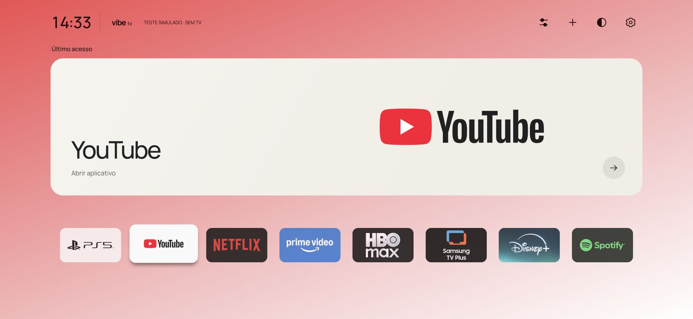

# Handoff — Vibe TV 1.1.5 / fundos por app e seleção sem borda

20/10/2026 · Samsung UN50AU8000GXZD · coordenador Codex `/root`.

## Entrega e estado real

- **1.1.5 assinada, atualizada diretamente e aberta na TV.** Ícones cerca de 7% maiores; seleção com pequeno aumento, sombra discreta e **sem borda/anel**, conforme a correção do proprietário após testar 1.1.4. Sem transições/animações.
- Fundo acompanha o último app aberto com sucesso pelo Vibe: YouTube vermelho→branco, Netflix vermelho→preto, Prime azul, Max roxo, Samsung laranja/violeta, Disney verde-azulado, Spotify verde e PS5 com a imagem fornecida. Foco/falha não mudam o fundo. Temas preservados nos painéis e em apps extras desconhecidos.
- Consulta automática e abertura por identidade nativa preservadas. **72/72 testes passaram**; oito paletas, foco sem borda, imagens e layouts 1280×720/390×844 verificados no navegador. Pacote assinado tem os mesmos 24 arquivos de runtime do source/unsigned.
- **Home curto já abre Vibe**, confirmado anteriormente após YouTube. Roteamento e reversão não foram repetidos nesta revisão. Smart Hub/firmware permanecem.
- Aprovação física anterior sem animações preservada; não houve novo benchmark de latência/FPS. A confirmação da aparência/rapidez da 1.1.5 e os ciclos YouTube→Home→YouTube, HDMI/CEC, menu Samsung, demais sessões e boot seguem pendentes.
- Prévia local ativa: [127.0.0.1:4173](http://127.0.0.1:4173), sem conexão à TV.



[Netflix](brand-background-netflix.jpg) · [Prime](brand-background-prime.jpg) · [Max](brand-background-max.jpg) · [Samsung](brand-background-samsung.jpg) · [Disney](brand-background-disney.jpg) · [Spotify](brand-background-spotify.jpg) · [PS5](brand-background-ps5.jpg) · [layouts](brand-background-layouts.jpg). São capturas simuladas, não fotos da televisão.

## Pedido original e pedido otimizado

Original: clonar Free My TV no GitHub de Felipe como vibe-tv, reconstruir a interface preservando aplicativos/configurações/logins; cartão de último acesso; PS5 HDMI 2 com artes fornecidas; ordem YouTube, PS5, Netflix, Prime, HBO Max, Samsung TV Plus, Disney+, Spotify; organização, temas, prints e documentação. Depois pediu Home nativo e reformulação baseada no CleanFrame, mantendo seu cartão grande.

Pedido desta continuação: aumentar um pouco os ícones inferiores; fundo baseado no último app aberto, com os exemplos YouTube vermelho→branco, Netflix vermelho→preto e PS5 com sua arte; seleção elevada sem perder desempenho. Após instalar 1.1.4, o proprietário pediu retirar a borda preta.

**Pedido otimizado:** aplicar ícones maiores e fundos estáticos por último acesso, com destaque por escala/sombra **sem borda**, preservando resposta imediata, atualização automática, artes/contas/rota Home; validar, atualizar a TV, registrar capturas e publicar a branch.

## Decisões e restrições

- Spec Kit **v1.0.3**, constituição 1.2.0, já autorizado/configurado. Tracker único `specs/001-vibe-tv-tizen/tasks.md`. Não perguntar novamente nem atualizar ferramentas automaticamente.
- AU8000, firmware T-NKLAUABC-2310.0, ARMv7/Tizen 6.0/Chromium 76; runtime .NET 3.1.3. Identidade WGT `VibeTV2026.VibeTV`, pacote `VibeTV2026`, perfil Samsung local `VibeTV`.
- Backup integral inicialmente exigido foi dispensado pelo proprietário em favor do reset oficial como fallback. **Não há backup integral nem garantia de recuperar logins/configurações após reset.** Reset não foi executado. O teste nativo posterior foi autorizado com o aviso de que reset não garante sua recuperação.
- Autorização nativa limitada: identidade/backup consistente, somente Home curto e reversão. Não autoriza firmware, boot relay, root persistente, alterações globais de autenticação, partições ou remoção de apps. **Não repetir root para corrigir UI.**
- Instalar/atualizar Vibe e commit/push desta branch estão autorizados. Não abrir PR, integrar em main, force push ou limpar worktrees sem pedido.
- Assets originais/PS5 preservados; sem extração de contas/tokens. Histórico privado/episódios não estão integrados. O hero registra apenas aberturas bem-sucedidas feitas pelo Vibe.

## Arquitetura e fluxo

App estático sem novas dependências. `state.js` mantém `vibe-tv.preferences.v1`; `app.js` controla hero/favoritos/painéis; `navigation.js` resolve foco e IDs seguros; `platform.js` limita APIs/timeout e propaga falhas. `background-support=disable` permanece.

`refreshInventory()` retorna a Promise compartilhada. Startup, retorno por `visibilitychange`/foco da janela, Adicionar e favorito sem alvo a reutilizam. Retorno durante consulta antiga agenda uma nova consulta sequencial; nenhum polling. Falha preserva inventário conhecido, sucesso substitui inclusive vazio. Foco dos botões não consulta. Eventos separados pela conclusão podem causar consultas sequenciais: não há deduplicação temporal universal.

`launch()` abre imediatamente alvos conhecidos. Para desconhecidos reserva a intenção, aguarda a consulta mais recente, revalida o favorito/ID e só então chama a API. Sair cancela a intenção que ainda aguarda inventário, antes da API nativa, mesmo se voltar antes de terminar; remover favorito não abre outro. Callback nativo confirma histórico; falhas liberam busy e não gravam acesso. `finishLaunch()` também limpa busy na fileira reconstruída.

CSS não contém transições/animações. O foco aumenta/destaca o próprio ícone imediatamente; nomes continuam no aria-label e na organização. `renderHero()` define `body[data-app]` a partir do mesmo `brandId` usado pelo cartão. Sem histórico usa o primeiro atalho; extra desconhecido/lista vazia usa o tema. Esse caminho não roda por tecla. Sete gradientes estáticos e a imagem PS5 já existente substituem o fundo; os painéis preservam o tema. Nenhuma extração dinâmica de cores de apps adicionais. Não acrescentar `will-change`, polling ou animações por hipótese de desempenho.

PS5 usa o objeto real HDMI 2 de connected/disconnected, `setSource`, depois `org.tizen.tv-viewer`. O bloqueio indevido por falta de sinal foi corrigido na 1.0.4; CEC/wake ainda não confirmado. Ajustes oferece o destino Samsung observado `com.samsung.tv.csfs`, sem registrar histórico; acesso físico pendente.

`tools/native-home/` é separado do app:

1. `transport.py` exige identidade física previamente fixada, modelo, Developer Mode e host correto; callback/token/deadline, sem retry. Detecta `error:` mesmo com exit0 do SDB.
2. `run.py` aceita somente identity/backup/apply/restore, serializa operações e compila um único modo. Upload usa UID5001:100; execução SDK usa 901:901. Copia arquivos recebidos para destinos SDK 644, confere hashes e elimina entrada gravável antes de elevar privilégios.
3. `namespace/`: montagens privadas temporárias, baseline owner5001:100, depois root 0:0; sem alteração global de passwd/chave; watchdog/timeout e hash após desmontagem.
4. `control/`: SQLite backup API; SHA do backup compilado no APPLY; schema e linhas guardados dentro da transação; notificação vconf e inversão conservadora em falha. Snapshot consistente posterior para comparar as três tabelas. Artifacts privados5001:100/0600 para transferência.
5. SQL altera exclusivamente a regra curta XF86Home e registro managed_app do Vibe. A regra Samsung registradora, Home longo e outras linhas permanecem. Restore recusa dependências desconhecidas.
6. Limpeza exige auth original, ausência de helpers e apenas nomes conhecidos. Journals PERSIST dos snapshots só são removidos com cabeçalho zerado e arquivo regular; arquivos ativos/links/FIFO são recusados.

CleanFrame original usa outro método em The Frame 2024/Tizen 9. A AU8000 não tem o símbolo `aul_get_default_app`; adaptação segue o caminho QN90A/Tizen 6 do Couchroot com guardas próprias. Referências fixadas e licenças em [cleanframe-home.md](../docs/vibe-tv/cleanframe-home.md).

## Recuperação — fazer antes de desinstalar

**Não remova o Vibe enquanto Home apontar para ele.** Primeiro restaure/verifique a rota Samsung com o helper e o backup local.

Preserve neste Mac, fora do Git:

- `.dev/native-home/backup-cb19e4cb6a134983/`: original consistente, SHA e metadados verificados.
- `.dev/native-home/device.json`: identidade confirmada usada pelo runner.
- `.dev/native-home/RECOVERY.md`: comando exato com o endereço observado, que pode mudar por DHCP.
- Evidências de operações `.dev/native-home/{identity,backup,apply,restore}-*/`.

Forma do comando, executada somente dentro do escopo de recuperação solicitado:

```sh
python3 tools/native-home/run.py restore --host "$VIBE_TV_HOST" \
  --backup .dev/native-home/backup-cb19e4cb6a134983
```

A reversão já foi testada com comparação integral das três tabelas/rowids. Ela depende de TV acessível por SDB, identidade/firmware compatíveis e guardas satisfeitas. **Não garante recuperar qualquer falha e não restaura logins/firmware/configurações gerais.** Em erro/resultado incerto, inspecione o estado e os logs privados antes de tentar novamente; não apague evidências como atalho.

## Tarefas e continuidade

| ID | Estado | Evidência / próxima ação |
| --- | --- | --- |
| T022 responsividade | done | Ensaio físico anterior sem animações aprovado; comportamento preservado |
| T025–T027 revisão 1.1.3 | done | Consulta automática/ícones e publicação anteriores preservados |
| T028 fundos/ícones | done | Dois RED → 30 controller / 72 total GREEN; oito fundos, layouts e seleção sem borda conferidos |
| T029 validar/instalar/publicar | in_progress | 1.1.5 instalada/aberta, capturas e docs prontos; concluir commit/push e conferir SHA |
| T016 abertura repetida | pending | Receber teste físico YouTube→Home→YouTube |
| T009 hardware geral | in_progress | Outros apps/sessões, configurações, imagem/áudio, boot e percepção da nova apresentação |
| T017 PS5 | in_progress | Confirmar imagem HDMI 2 e despertar CEC separadamente |
| T021 Home nativo | in_progress | YouTube→Home confirmado; falta HDMI→Home/menu Samsung/boot |

T028 depende de T027 e pedido explícito; T029 depende de T028. Agentes fizeram somente revisão independente. Itens físicos não são encerrados por simulação.

Ao retomar: ler este handoff, spec/tracker e `git status`; preservar seleção sem borda e ausência de animação. Receber feedback físico sem reinstalar/resetar por rotina. Se houver falha, medir o caso e distinguir API/foco/abertura; não repetir root para ajustes visuais. Recuperar rota somente no escopo autorizado e com as guardas existentes.

## Arquivos alterados nesta revisão

- `package.json`: escopo CommonJS explícito para os testes, sem dependências ou alteração no pacote da TV.
- `tizen/app.js`: atributo `data-app` reaproveita identidade do hero; versão 1.1.5 exibida.
- `tizen/styles.css`: oito fundos, texto contrastante do hub, ícones maiores e sombra sem borda/transição. Assets originais inalterados.
- `tizen/config.xml`: versão 1.1.5; ID/permissões preservados.
- `tests/controller.test.cjs`: dois testes de vínculo do fundo a sucesso/hero e fallback.
- `tests/ui-fixture.cjs`: cenário `?catalog=all` para os oito fundos, mantendo cenários de falha/recuperação; não vai no WGT.
- `specs/001-vibe-tv-tizen/{spec,plan,tasks}.md`: FR022/023, correção sem borda e evidência.
- `README.md`, `docs/vibe-tv/{installation,validation}.md`: comportamento, versão e validações.
- `outputs/brand-background-*.jpg`: oito marcas/layouts simulados; este handoff.

## Validação e limites da medição

```sh
node --test tests/*.test.cjs                 # 72/72 nesta revisão
node --check tizen/app.js
node --check tests/ui-fixture.cjs
node tools/package-tizen.cjs
git diff --check
SPECIFY_FEATURE_DIRECTORY=specs/001-vibe-tv-tizen .specify/scripts/bash/check-prerequisites.sh --json --require-spec --require-tasks --include-tasks
```

TDD: dois novos RED no controller, depois 30/30 controller e 72/72 totais. Sucesso muda o fundo; foco/falha não; custom conhecido resolve marca e desconhecido/vazio usam fallback. CSS trivial validado no navegador, sem teste que apenas copie a implementação. Revisores independentes não encontraram impedimentos; coordenador inspecionou diff e resultados.

Browser: oito fundos e zero imagens quebradas, transição 0 s, nomes acessíveis, painéis do tema preservados. Foco final: border 0 px/outline none no botão/tile, sombra única curta, escala 1,12 e deslocamento−4 px. 1280×720/390×844 sem overflow da página; extremidades e sombra cabem, ↑hero/↓primeiro favorito e ordem salva corretos. Capturas finais foram refeitas após retirar a borda. Contraste calculado do texto do hub nos sete gradientes ficou ≥4,85:1; é checagem das paletas, não certificação global.

Pacotes 1.1.4 e 1.1.5: CRC/XML/ID/versão válidos e 24 runtime iguais a source/unsigned. A 1.1.4 abriu na TV e o usuário rejeitou sua borda; removida na 1.1.5. Atualização direta 1.1.5 retornou `install completed`, `was_execute` retornou `launched`. Somente Vibe foi encerrado; não usar `tz install`, cujo wrapper observado desinstala primeiro. Nenhum novo root/roteamento/reset/firmware/conta alterado.

Evidência física histórica 1.1.2: 397 apps em 3.212 ms; 79 setas com transições tiveram fila p95 de 321 ms e 39 sem transições p95 de 6 ms. Ensaios manuais diferentes, possível interferência inicial; não são FPS nem botão→pixel. Proprietário aprovou sem animações. **Não atribuir esses números à 1.1.5**: não foi feito novo benchmark. A sombra estática ainda tem custo de pintura; percepção final permanece não verificada.

Na última validação, Node herdou `type: module` do diretório pai deste repositório e falhou ao carregar os módulos UMD pelos testes CommonJS. O source da TV estava inalterado. Um `package.json` mínimo com `type: commonjs` delimita o projeto sem tocar no arquivo externo; a mesma suíte voltou a 72/72 com Node 25.8.1. Nenhuma dependência foi instalada e esse arquivo não entra no WGT.

Native Python 16/C# 38 são históricos; helpers não mudaram e não foram reexecutados nesta revisão. Home/HDMI/CEC/boot/sessões pendentes continuam no tracker.

## Git e execução local

Raiz `/Users/felipemedici/Documents/quadro-branco/vibe-tv`.
Branch **agent/vibe-tv-cleanframe**: [GitHub](https://github.com/femedici/vibe-tv/tree/agent/vibe-tv-cleanframe).
Base desta continuação: `07027a1e0b1df91d948b19880a42a3ce8a5d8e25`. Commit/push desta revisão em andamento; conferir receipt após publicação. Nenhum PR/merge em main.

Worktrees preservadas: `.worktrees/cleanframe-ui` (`agent/cleanframe-interface`), `.worktrees/native-home` (`agent/au8000-native-home`) e anteriores de state/platform/interface. Só o coordenador escreveu esta revisão; agentes foram revisores somente leitura.

```sh
cd /Users/felipemedici/Documents/quadro-branco/vibe-tv
node tools/preview.cjs
# http://127.0.0.1:4173 — reutilizar o servidor já ativo
```

Fixture 4175 foi encerrada após os testes. `.dev/`, `dist/`, certificados, perfis, chaves, WGT assinado, endereços privados, DUID e número de série ficam fora do Git. Preserve backup/RECOVERY; não extrair/publicar contas.
