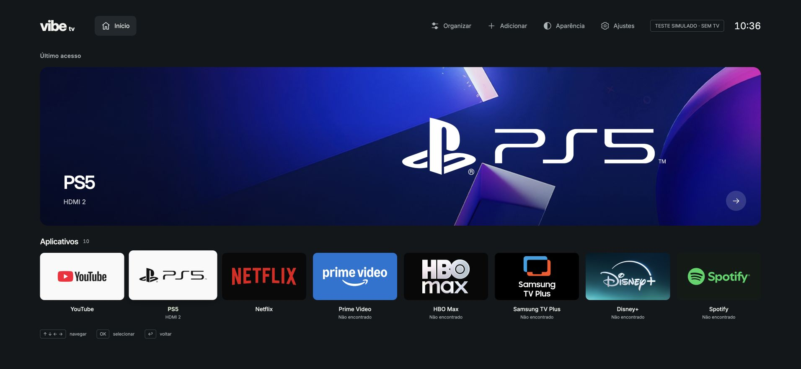

# Handoff — Vibe TV 1.0.4

20/10/2026 · Samsung UN50AU8000GXZD · Codex `/root`.

## Entrega e pendências

**1.0.4 assinada, instalada por atualização direta e aberta na TV.** Corrigido o bloqueio que impedia selecionar HDMI 2 quando o PS5 não fornecia sinal: agora o Vibe consulta também as entradas enumeradas como desconectadas. A fonte continua sendo o objeto real da TV, com confirmação da API antes de abrir o viewer nativo. Não há comando próprio de ligar o PS5.

- 45 testes passaram; regressão HDMI passou de RED 15/18 para GREEN 18/18.
- Fluxo de interface verificado localmente com HDMI2 sem sinal simulado: viewer chamado, hero PS5 e foco preservado.
- Runtime instalado confirmou versão 1.0.4. O clique físico no PS5 foi acionado, mas o Inspector desconectou antes de ler o resultado. **Imagem HDMI e despertar por CEC aguardam confirmação do proprietário. Desconexão não é prova de sucesso.**
- O proprietário informou que o YouTube abriu corretamente após o relato anterior. Nenhuma causa da falha de reabertura foi reproduzida; não foi aplicada correção especulativa. Ciclos consecutivos ainda precisam de verificação.
- **Home continua abrindo Smart Hub. Substituição global solicitada não foi implementada:** não há mecanismo público documentado para promover esse aplicativo Tizen a launcher/Home nessa TV. Autorun Last App não remapeia o botão.

Prévia disponível em [127.0.0.1:4173](http://127.0.0.1:4173). A captura abaixo é de uma fixture explicitamente simulada, com serviços ausentes e apps extras de teste; não é fotografia da televisão.



## Pedido original e pedido otimizado

Original: clonar `simbasjungles/free-my-tv` em `femedici/vibe-tv`, reconstruir a interface, preservar configurações e contas, último app em destaque, artes/ações reais, PS5 HDMI2 com imagens fornecidas, favoritos editáveis na ordem YouTube, PS5, Netflix, Prime, HBO Max, Samsung TV Plus, Disney+, Spotify; temas claro/escuro/cinza/pastel/vinho, fluidez, capturas, documentação e publicação. Depois pediu logos originais, remoção de textos supérfluos, controles no topo e foco suave. Último pedido: PS5 deve selecionar HDMI2 e ligar como no Smart Hub; Home deve abrir Vibe sem depender do hub Samsung.

**Pedido otimizado:** corrigir o atalho PS5 para reproduzir o comportamento do HDMI 2 da Samsung, incluindo ligar o console quando possível, e verificar o que seria necessário para Home abrir o Vibe TV, preservando apps, contas e configurações. Separar evidência de seleção da entrada, imagem e despertar por CEC; registrar o limite público de Home sem fingir substituição do sistema.

## Decisões e autorizações

- Spec Kit v1.0.3 já inicializado/aprovado; constituição existente. Não perguntar novamente nem atualizar a ferramenta automaticamente.
- Upstream é Android; usuário aprovou um app Tizen separado e o melhor resultado suportado. O pedido posterior de Home global permanece registrado como não atendido, sem execução de firmware/root.
- Backup integral inicialmente exigido foi dispensado expressamente em favor do reset oficial como fallback, após explicar perda de sessões/configurações e impossibilidade de garantir recuperação/downgrade de firmware. **Backup não existe; reset não executado.**
- Developer Mode, conexão, certificado, instalação/atualização exclusiva do Vibe e testes de apps/HDMI autorizados. Certificado Samsung já criado pelo proprietário; não recriar nem pedir senhas.
- Commit e push da branch autorizados. Sem PR, merge/main, force push ou limpeza de worktrees.
- Não resetar a TV/Smart Hub, limpar apps, extrair tokens, desativar componentes ou substituir firmware como atalho.

## Arquitetura e causa verificada

App estático HTML/CSS/JS, sem backend/dependências de runtime. Chromium 76 / Tizen 6.0. Privilégios públicos existentes: `application.launch` e `tv.window`.

- `state.js`: preferências próprias em `vibe-tv.preferences.v1` (tema/ordem/favoritos/último lançamento). Sem credenciais.
- `app.js`: hero, marcas, painéis, foco e cache de renderização; hero/favorito passam pelo mesmo `launch()`. PS5 chama `platform.launchInput(2)`. Só sucesso registra histórico.
- `navigation.js`: geometria por bordas; inventário real e aliases/IDs observados, rejeitando ambiguidades.
- `platform.js`: callbacks Tizen em Promises com timeout de 5 s; erro de etapa preservado. HDMI2 enumera `VIDEOSOURCE`, encontra o único objeto nas listas connected/disconnected, chama `setSource(..., 'MAIN')` e depois `org.tizen.tv-viewer`. Falha após troca informa `SOURCE_CHANGED`.
- `preview.cjs`: loopback, somente arquivos de `tizen/`; sem ações reais da TV.
- `package-tizen.cjs`: 20 arquivos de runtime/assets em WGT não assinado; assinatura separada com perfil local VibeTV.

**Reprodução física anterior à correção:** `connected` continha apenas TV1; `disconnected` continha AV1/HDMI1/HDMI2/HDMI3, todos com sinal desconhecido. O Vibe procurava apenas em connected e também rejeitava signal false. O clique mostrou indisponibilidade; getSource permaneceu TV1. Era um bloqueio do próprio adaptador antes de chamar a Samsung.

A correção não promete CEC: ausência de vídeo não torna a porta inexistente, mas aceitar setSource também não prova ligar o console. Nenhum endpoint privado ou permissão adicional foi introduzido.

## Trabalho anterior preservado

Grande cartão do último lançamento pelo Vibe; primeiro favorito como Acesso rápido sem histórico fictício; sete marcas originais locais e ícones nativos/fallback neutro para apps extras; artes PS5 fornecidas; cinco temas; favoritos editáveis. Controles no topo direito, ↓ do hero para apps, ↑ retorna, destaque por transform/opacity de 150 ms sem retângulo externo. As imagens/histórico de episódios permanecem privados aos provedores; nenhuma integração de retomada existe.

## Tracker único e dependências

`specs/001-vibe-tv-tizen/tasks.md` é a fonte de verdade; somente coordenador atualiza.

- T001–T008/T010–T015: fase local, artes, foco, documentação/publicação e investigação Home concluídos nos respectivos escopos.
- T009: validação física parcial em andamento. Demais serviços/sessões, PS5/CEC, HDR/áudio/Game Mode/latência e autorun pendentes.
- T016: pending; usuário informou abertura correta, mas sequência repetida de abrir/retornar/reabrir não observada integralmente. Sem causa reproduzida ou código alterado por hipótese.
- T017: in_progress, depende T014. Correção/testes/revisão/assinatura/instalação feitos; resultado físico PS5 ainda depende da resposta do proprietário.

Pesquisa independente de Home e revisão da correção foram somente leitura. Root integrou as mudanças sequencialmente; não houve outro agente escritor nesta continuação.

## Arquivos alterados nesta continuação

- `tizen/platform.js`: seleção de HDMI2 enumerado sem exigir sinal ativo.
- `tizen/app.js`, `config.xml`: versão 1.0.4.
- `tests/platform.test.cjs`: regressões de entrada desconectada/sem sinal e ambiguidade entre listas.
- `tests/ui-fixture.cjs`: simula a enumeração observada na TV sem se conectar ao aparelho.
- `specs/001-vibe-tv-tizen/{spec.md,plan.md,tasks.md,contracts/modules.md}`: contrato vivo, execução e estado real.
- `README.md`, `docs/vibe-tv/{compatibility,installation,validation}.md`: causa, atualização e limites.
- `outputs/vibe-tv-1.0.4-ps5-simulated.png` e este handoff: evidência e continuidade.

`dist/` e `.dev/` ignorados/privados. Não publicar pacotes assinados, certificados, senhas, DUID, IP ou serial do aparelho.

## Validação executada

- `node --test tests/platform.test.cjs`: RED 15/18 (3 falhas), depois GREEN 18/18.
- `node --test tests/*.test.cjs`: 45/45, zero falhas. Estado13, plataforma18, navegação9, controlador3, ferramentas2.
- Sintaxe dos scripts, `git diff --check` e prerequisites Spec Kit passaram.
- Navegador real na fixture: YouTube→PS5; `data-test-source=HDMI2`, chamada `org.tizen.tv-viewer`, hero PS5, foco `favorite-ps5`, toast oculto. Captura salva e inspecionada.
- ZIP/CRC/XML/versão válidos; 20 arquivos iguais entre unsigned e signed; somente duas assinaturas XML adicionadas, além de entradas de diretório.
- Atualização por SDB push + `vd_appinstall`: `install completed`. Só Vibe reiniciado; novo processo e versão 1.0.4 confirmados no Inspector.
- Revisor independente: sem achados acionáveis, 18 testes e casos adicionais de objetos congelados/duplicatas passaram. Coordenador leu todo o diff e executou suas próprias verificações.
- Cliques físicos finais: resultado visual pendente. Não afirmar wake, imagem/HDR/latência ou preservação de todas as sessões a partir de teste simulado.

## Git e publicação

Repo: [femedici/vibe-tv, branch agent/vibe-tv](https://github.com/femedici/vibe-tv/tree/agent/vibe-tv).

Raiz: `/Users/felipemedici/Documents/quadro-branco/vibe-tv`. Branch de integração `agent/vibe-tv`; origin fork e upstream original preservados. Base desta continuação: `9597ae2dabedd500e490c2a6e68f86fd5ca4b96f`. Código Android, histórico e licença MIT mantidos.

Publicação 1.0.4: commit `709d72f7dc51f402f3d52120117f6c361cf04f1f` enviado; `git ls-remote` confirmou o mesmo SHA de HEAD. Este registro de evidência segue na mesma branch. A publicação não declara concluídas as pendências físicas T017/T009 nem a troca global de Home.

Worktrees mantidas: `.worktrees/state` (agent/vibe-tv-state), `.worktrees/platform` (agent/vibe-tv-platform), `.worktrees/interface` (agent/vibe-tv-interface). Nenhuma limpeza automática. Base comum original c084d09.

## Como retomar e testar

```sh
cd /Users/felipemedici/Documents/quadro-branco/vibe-tv
git status --short
node --test tests/*.test.cjs
node tools/preview.cjs
```

Reutilizar o servidor 4173 se já estiver ativo. Para teste de integração isolado, `node tests/ui-fixture.cjs` serve 4175 com aviso explícito de simulação; sem npm install.

```sh
node tools/package-tizen.cjs
SPECIFY_FEATURE_DIRECTORY=specs/001-vibe-tv-tizen .specify/scripts/bash/check-prerequisites.sh --json --require-spec --require-tasks --include-tasks
```

Próxima ação concreta: receber a resposta à pergunta já enviada — PS5 ligou e mostrou imagem, foi para HDMI2 sem ligar ou permaneceu no Vibe/erro. Não reiniciar novamente o app/TV enquanto o proprietário verifica a tela. Se falhou, capturar a etapa/erro real e distinguir seleção de fonte versus wake, antes de nova alteração.

Ferramentas oficiais já estão em `~/.tizen-extension-platform/server/sdktools/`, perfil VibeTV pronto. Conferir `sdb devices`/modelo porque DHCP mudou. Seguir [instalação](../docs/vibe-tv/installation.md); evitar `tz install`, cujo wrapper observado desinstala primeiro. Atualizar diretamente com vd_appinstall; preservar dados. Porta e página do Inspector são temporárias. CUA é o meio de interação com navegador/Inspector; não acessar sessões privadas.

## Fontes dos limites

- [SystemInfo / entradas e sinal](https://developer.samsung.com/smarttv/develop/api-references/tizen-web-device-api-references/systeminfo-api.html).
- [TVWindow 6.0 / setSource](https://github.com/Samsung/tizen-docs/blob/master/docs/application/web/api/6.0/device_api/tv/tizen/tvwindow.html).
- [Viewer nativo, FAQ Q12](https://developer.samsung.com/smarttv/develop/faq/other-features.html).
- [Home — checklist CO-GE-07](https://developer.samsung.com/smarttv/develop/development-checklist/common.html) e [teclas da plataforma — FAQ Q7](https://developer.samsung.com/smarttv/develop/faq/user-interaction.html).

Não transformar a referência Android ou o autorun em promessa de Home global na Samsung. [Validação detalhada](../docs/vibe-tv/validation.md), [compatibilidade](../docs/vibe-tv/compatibility.md) e [recuperação](../docs/vibe-tv/recovery.md) distinguem evidências e pendências.
