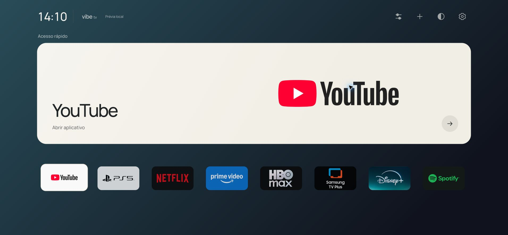

# Handoff — Vibe TV 1.1.3 / resposta imediata e ícones

20/10/2026 · Samsung UN50AU8000GXZD · coordenador Codex `/root`.

## Entrega e estado real

- **1.1.3 assinada, atualizada diretamente e aberta na TV.** Sem transições/animações; favoritos só com ícones originais, nomes acessíveis preservados e sem fundo retangular coletivo. Cinco degradês estáticos atrás do cartão de último acesso.
- Proprietário testou na versão 1.1.2 a remoção temporária das animações na própria AU8000 e aprovou: **“perfeito! mantenhjaassim, com a alteração dos icones”**. Esse comportamento está permanente na nova versão. O feedback aprovado substitui a preferência anterior por animação de 150 ms.
- Lista consultada automaticamente ao entrar/voltar e ao abrir Adicionar. Um favorito ainda não identificado aguarda a consulta e abre com **um único clique** quando existe um ID seguro. Abertura duplicada, intenção antiga após sair e busy residual foram corrigidos; botão manual removido. Apps conhecidos continuam abrindo durante consulta.
- **70/70 testes Node passaram**; cinco temas, nomes acessíveis, proporções e navegação nos tamanhos 1280×720/390×844 verificados em navegador. Pacote assinado contém os mesmos 24 arquivos de runtime do source/unsigned.
- **Home curto já abre Vibe**, confirmado pelo proprietário após YouTube. A aplicação/restauração/reaplicação do roteamento foi verificada anteriormente; não foi repetida nesta revisão. Smart Hub continua instalado e o firmware é o original.
- Confirmação final da 1.1.3 para **YouTube → Home → YouTube sem atualização manual** foi solicitada e ainda não chegou neste registro. HDMI/CEC, menu Samsung, demais sessões e boot permanecem separados e pendentes.
- Prévia local em execução: [127.0.0.1:4173](http://127.0.0.1:4173). Ela não se conecta à TV.



Capturas da prévia: [claro](immediate-icons-light.jpg), [cinza](immediate-icons-gray.jpg), [pastel](immediate-icons-pastel.jpg), [vinho](immediate-icons-wine.jpg). Não são fotos da televisão.

## Pedido original e pedido otimizado

Original: clonar Free My TV no GitHub de Felipe como vibe-tv, reconstruir a interface preservando aplicativos/configurações/logins; cartão de último acesso; PS5 HDMI 2 com artes fornecidas; ordem YouTube, PS5, Netflix, Prime, HBO Max, Samsung TV Plus, Disney+, Spotify; organização, temas, prints e documentação. Depois pediu Home nativo e reformulação baseada no CleanFrame, mantendo seu cartão grande.

Pedido desta continuação: eliminar o atraso nas setas, deixar apenas ícones sem nomes/faixa coletiva, fundos em degradê por tema e aplicativos atualizados sem clique manual. Após comparação física, aprovou manter o modo sem animações.

**Pedido otimizado:** tornar permanente a resposta imediata aprovada na TV, aplicar os ícones e degradês solicitados, recuperar a consulta de apps automaticamente sem segundo clique, preservar identidade/contas/rota Home e entregar código validado, atualização assinada, capturas, documentação e branch publicada.

## Decisões e restrições

- Spec Kit **v1.0.3**, constituição 1.2.0, já autorizado/configurado. Tracker único `specs/001-vibe-tv-tizen/tasks.md`. Não perguntar novamente nem atualizar ferramentas automaticamente.
- AU8000, firmware T-NKLAUABC-2310.0, ARMv7/Tizen 6.0/Chromium 76; runtime .NET 3.1.3. Identidade WGT `VibeTV2026.VibeTV`, pacote `VibeTV2026`, perfil Samsung local `VibeTV`.
- Backup integral inicialmente exigido foi dispensado pelo proprietário em favor do reset oficial como fallback. **Não há backup integral nem garantia de recuperar logins/configurações após reset.** Reset não foi executado. O teste nativo posterior foi autorizado com o aviso de que reset não garante sua recuperação.
- Autorização nativa limitada: identidade/backup consistente, somente Home curto e reversão. Não autoriza firmware, boot relay, root persistente, alterações globais de autenticação, partições ou remoção de apps. **Não repetir root para corrigir UI.**
- Instalar/atualizar Vibe e commit/push desta branch estão autorizados. Não abrir PR, integrar em main, force push ou limpar worktrees sem pedido.
- Assets originais/PS5 preservados; sem extração de contas/tokens. Histórico privado/episódios não estão integrados. O hero registra apenas aberturas bem-sucedidas feitas pelo Vibe.

## Arquitetura e fluxo

App estático sem novas dependências. `state.js` mantém `vibe-tv.preferences.v1`; `app.js` controla hero/favoritos/painéis; `navigation.js` resolve foco e IDs seguros; `platform.js` limita APIs/timeout e propaga falhas. `background-support=disable` permanece.

`refreshInventory()` retorna a Promise compartilhada. Startup, retorno por `visibilitychange`/foco da janela, Adicionar e favorito sem alvo a reutilizam. Retorno durante consulta antiga agenda uma nova consulta sequencial; nenhum polling. Falha preserva inventário conhecido, sucesso substitui inclusive vazio. Foco dos botões não consulta. Eventos separados pela conclusão podem causar consultas sequenciais: não há deduplicação temporal universal.

`launch()` abre imediatamente alvos conhecidos. Para desconhecidos reserva a intenção, aguarda a consulta mais recente, revalida o favorito/ID e só então chama a API. Sair cancela a intenção que ainda aguarda inventário, antes da API nativa, mesmo se voltar antes de terminar; remover favorito não abre outro. Callback nativo confirma histórico; falhas liberam busy e não gravam acesso. `finishLaunch()` também limpa busy na fileira reconstruída.

CSS não contém transições/animações. O foco aumenta/destaca o próprio ícone imediatamente; nomes continuam no aria-label e na organização. Gradientes são estáticos, sem camadas animadas. Não acrescentar `will-change`, polling ou animações por hipótese de desempenho.

PS5 usa o objeto real HDMI 2 de connected/disconnected, `setSource`, depois `org.tizen.tv-viewer`. O bloqueio indevido por falta de sinal foi corrigido na 1.0.4; CEC/wake ainda não confirmado. Ajustes oferece o destino Samsung observado `com.samsung.tv.csfs`, sem registrar histórico; acesso físico pendente.

`tools/native-home/` é separado do app:

1. `transport.py` exige identidade física previamente fixada, modelo, Developer Mode e host correto; callback/token/deadline, sem retry. Detecta `error:` mesmo com exit0 do SDB.
2. `run.py` aceita somente identity/backup/apply/restore, serializa operações e compila um único modo. Upload usa UID5001:100; execução SDK usa 901:901. Copia arquivos recebidos para destinos SDK 644, confere hashes e elimina entrada gravável antes de elevar privilégios.
3. `namespace/`: montagens privadas temporárias, baseline owner5001:100, depois root 0:0; sem alteração global de passwd/chave; watchdog/timeout e hash após desmontagem.
4. `control/`: SQLite backup API; SHA do backup compilado no APPLY; schema e linhas guardados dentro da transação; notificação vconf e inversão conservadora em falha. Snapshot consistente posterior para comparar as três tabelas. Artifacts privados5001:100/0600 para transferência.
5. SQL altera exclusivamente a regra curta XF86Home e registro managed_app do Vibe. A regra Samsung registradora, Home longo e outras linhas permanecem. Restore recusa dependências desconhecidas.
6. Limpeza exige auth original, ausência de helpers e apenas nomes conhecidos. Journals PERSIST dos snapshots só são removidos com cabeçalho zerado e arquivo regular; arquivos ativos/links/FIFO são recusados.

CleanFrame original usa outro método em The Frame 2024/Tizen 9. A AU8000 não tem o símbolo `aul_get_default_app`; adaptação segue o caminho QN90A/Tizen 6 do Couchroot com guardas próprias. Referências fixadas e licenças em [cleanframe-home.md](../docs/vibe-tv/cleanframe-home.md).

## Recuperação — fazer antes de desinstalar

**Não remova o Vibe enquanto Home apontar para ele.** Primeiro restaure/verifique a rota Samsung com o helper e o backup local.

Preserve neste Mac, fora do Git:

- `.dev/native-home/backup-cb19e4cb6a134983/`: original consistente, SHA e metadados verificados.
- `.dev/native-home/device.json`: identidade confirmada usada pelo runner.
- `.dev/native-home/RECOVERY.md`: comando exato com o endereço observado, que pode mudar por DHCP.
- Evidências de operações `.dev/native-home/{identity,backup,apply,restore}-*/`.

Forma do comando, executada somente dentro do escopo de recuperação solicitado:

```sh
python3 tools/native-home/run.py restore --host "$VIBE_TV_HOST" \
  --backup .dev/native-home/backup-cb19e4cb6a134983
```

A reversão já foi testada com comparação integral das três tabelas/rowids. Ela depende de TV acessível por SDB, identidade/firmware compatíveis e guardas satisfeitas. **Não garante recuperar qualquer falha e não restaura logins/firmware/configurações gerais.** Em erro/resultado incerto, inspecione o estado e os logs privados antes de tentar novamente; não apague evidências como atalho.

## Tarefas e continuidade

| ID | Estado | Evidência / próxima ação |
| --- | --- | --- |
| T022 responsividade | done | Comparação física sem animações aprovada; comportamento instalado permanentemente |
| T025 ícones e temas | done | Diff, cinco temas, foco/aria/layouts e pacote verificados |
| T026 consulta/abertura automática | done | RED/GREEN, 28 controller/70 total; fixture de recuperação e revisão independente |
| T027 validar/instalar/publicar | done | Código/capturas/documentação publicados; SHA remoto conferido |
| T016 abertura repetida | pending | Receber teste físico YouTube→Home→YouTube 1.1.3 |
| T009 hardware geral | in_progress | Outros apps/sessões, configurações, imagem/áudio e boot |
| T017 PS5 | in_progress | Separar confirmação de imagem HDMI 2 e despertar CEC |
| T021 Home nativo | in_progress | YouTube→Home confirmado; falta HDMI→Home/menu Samsung/boot |

T025 depende da aprovação física; T026 de T024; T027 reúne T025/T026. Os itens físicos anteriores não impedem a entrega desta revisão nem devem ser marcados concluídos por testes simulados.

Ao retomar: ler este handoff, spec/tracker e `git status`; preservar a resposta sem animações aprovada. Receber o resultado físico pendente sem reinstalar/resetar por rotina. Se houver falha, medir o caso específico e distinguir API, foco e tempo de abertura. Não voltar a pedir autorização já concedida nem repetir o teste root. Só recuperar a rota quando solicitado e com as guardas existentes.

## Arquivos alterados nesta revisão

- `tizen/app.js`: ícones sem captions, Promise compartilhada, consulta automática em Adicionar/ativação, cancelamento e limpeza de busy; versão exibida 1.1.3.
- `tizen/styles.css`: sem animações/transições, material coletivo removido, ícones/foco e cinco degradês; assets inalterados.
- `tizen/config.xml`: versão 1.1.3; identidade/permissões preservadas.
- `tests/controller.test.cjs`: dez casos novos, incluindo consulta pendente, retorno, favorito removido, saída/cancelamento e busy.
- `tests/ui-fixture.cjs`: `?inventory=retry` falha inicialmente e recupera depois; nunca incluído no pacote.
- `specs/001-vibe-tv-tizen/{spec,plan,tasks}.md`: contrato/decisão/execução atuais.
- `README.md`, `docs/vibe-tv/{installation,validation,cleanframe-home}.md`: versão/evidência/procedimento.
- `outputs/immediate-icons-{dark,light,gray,pastel,wine}.jpg` e este handoff.

## Validação e limites da medição

```sh
node --test tests/*.test.cjs                 # 70/70 nesta revisão
node --check tizen/app.js
node --check tests/ui-fixture.cjs
node tools/package-tizen.cjs
git diff --check
SPECIFY_FEATURE_DIRECTORY=specs/001-vibe-tv-tizen .specify/scripts/bash/check-prerequisites.sh --json --require-spec --require-tasks --include-tasks
```

TDD: primeira rodada reproduziu 6 falhas em 23 testes; revisão adicionou 3 RED em 28; todos corrigidos, sem retirar testes. Revisão independente controller/plataforma sem achados após as correções. Native Python 16/C# 38 são evidência histórica; código nativo não mudou e não foi reexecutado nesta revisão.

Browser real: cinco temas, 1912×884 e frames 1280×720/390×844; captions 0, imagens quebradas 0, fundo coletivo transparente, transição 0 s, nomes acessíveis e setas até Spotify/↑hero. Fixture confirma uma ativação após falha inicial causa uma consulta nova e uma abertura, sem botão manual. Algumas prévias de captura mostraram hero vazio; a tela visível e os arquivos finais foram conferidos completos, inclusive por decodificação dos pixels quando o visualizador divergiu. Não foi estabelecido defeito no app nem introduzida correção especulativa de CSS.

Inspector físico funcionou na 1.1.2: 397 apps em 3.212 ms. Amostra original: 79 setas: fila de evento mediana 15 / p95 321 / máximo 398 ms; sem transições: 39 setas: mediana 4 / p95 6 / máximo 7 ms. Handler p95 10,4→6,7 ms, próximo callback rAF p95 16→8 ms. Amostras manuais diferentes, possível interferência de diagnóstico inicial; **não** são FPS nem botão→pixel. Proprietário aprovou a resposta percebida. Probe temporário não entrou no código; lançamento normal da 1.1.3 encerrou debug.

Pacote 1.1.3: CRC/XML/ID/versão válidos, 24 runtime iguais entre source/unsigned/signed; extras apenas assinaturas e diretórios. SDB reconfirmou modelo; `vd_appinstall` retornou `install completed`; somente Vibe anterior foi encerrado; `was_execute` retornou `launched`. Não usar `tz install`, pois o wrapper observado desinstala primeiro. Não houve mudança de rota, root, reset, firmware ou contas nesta revisão.

## Git e execução local

Raiz `/Users/felipemedici/Documents/quadro-branco/vibe-tv`.
Branch **agent/vibe-tv-cleanframe**: [GitHub](https://github.com/femedici/vibe-tv/tree/agent/vibe-tv-cleanframe).
Base desta continuação: `875c26651765cf670d04d5a5a5e10be9ee47aee6`. Implementação, capturas e documentação publicadas em `9bf72b2f88feec17ce829796c0eee7cab1a1e23c`; `git ls-remote` confirmou o mesmo SHA. Este recibo e o fechamento do tracker seguem na mesma branch. Nenhum PR/merge em main.

Worktrees preservadas: `.worktrees/cleanframe-ui` (`agent/cleanframe-interface`), `.worktrees/native-home` (`agent/au8000-native-home`) e anteriores de state/platform/interface. Só o coordenador escreveu esta revisão; agentes foram revisores somente leitura.

```sh
cd /Users/felipemedici/Documents/quadro-branco/vibe-tv
node tools/preview.cjs
# http://127.0.0.1:4173 — reutilizar o servidor já ativo
```

Fixture 4175 foi encerrada após os testes. `.dev/`, `dist/`, certificados, perfis, chaves, WGT assinado, endereços privados, DUID e número de série ficam fora do Git. Preserve backup/RECOVERY; não extrair/publicar contas.
