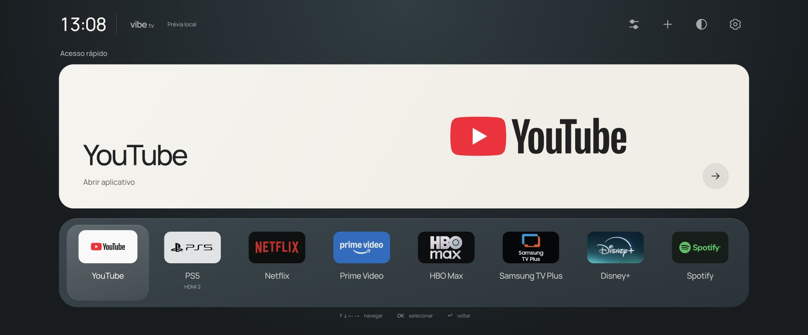

# Handoff — Vibe TV 1.1.1 / resposta do controle

20/10/2026 · Samsung UN50AU8000GXZD · coordenador Codex `/root`.

## Resultado entregue e estado atual

- Interface reformulada com base no CleanFrame: cartão grande de último acesso, dock, controles no topo direito, marcas proporcionais, artes PS5, cinco temas e foco suave. O desvio de ↓ após rolar o dock foi corrigido.
- Versão **1.1.1 assinada, atualizada diretamente e aberta na TV**. Setas seguem a ordem dos favoritos sem medir todo o hub; rolagem ocorre só quando necessária; apps já identificados podem abrir enquanto a lista é atualizada. Identidade/armazenamento preservados; nenhum outro aplicativo foi removido.
- **Home curto está configurado para Vibe TV**, por um helper nativo separado do WGT. Na própria AU8000, identidade root temporária, backup consistente, aplicação, restauração e reaplicação passaram. Snapshots confirmaram todas as três tabelas/rowids esperadas; notificações aceitas, autenticação global inalterada e staging removido.
- **O proprietário confirmou YouTube → Home curto → Vibe**, mas relatou lentidão. A otimização 1.1.1 está instalada; a melhora percebida no controle ainda aguarda resposta. Home desde HDMI, menu Samsung, PS5/CEC e boot também permanecem pendentes.
- Nesta revisão, **54/54 testes Node** passaram. A revisão nativa anterior passou 16 testes Python e 38 asserções C#; esses componentes não mudaram nesta atualização. Prévia local está rodando em [127.0.0.1:4173](http://127.0.0.1:4173).

Esta é uma mudança de interface e roteamento sobre o Tizen existente. Não houve troca de firmware, remoção do Smart Hub, reset, extração de contas ou instalação de root persistente.



As capturas `responsiveness-*` e `cleanframe-*` são do navegador real, explicitamente prévia/fixture. [Teste 1280/390](responsiveness-layouts.jpg). Não são fotos da televisão. [Ajustes 1.1.0](cleanframe-settings-1.1.0-1920.jpg) · [foco390](cleanframe-navigation-fixed-390.jpg) · [claro](cleanframe-light-1280.jpg) · [vinho](cleanframe-themes-wine.jpg).

## Pedido original e pedido otimizado

Original: clonar Free My TV no GitHub de Felipe como vibe-tv, reconstruir a interface da Samsung preservando apps, configurações e logins; destacar último acesso e conteúdo real; PS5 no HDMI2 com imagens fornecidas; favoritos na ordem YouTube, PS5, Netflix, Prime, HBO Max, Samsung TV Plus, Disney+, Spotify; permitir organização e temas; documentar, capturar telas e publicar. Depois solicitou substituir o comportamento de Home e refazer a partir dos exemplos de Nathan Clark/CleanFrame.

**Pedido atual:** Home abriu, mas o usuário considera a resposta do controle lenta e quer um hub leve e rápido.

**Pedido otimizado:** reduzir o atraso do controle no Vibe TV, preservando o visual, os apps e o Home confirmado. Identificar trabalho/bloqueios desnecessários, corrigir com testes e atualizar a TV; distinguir contagem de operações local de latência física. A autorização anterior do teste nativo continua limitada e não foi reutilizada nesta correção.

## Decisões e limites aprovados

- Spec Kit v1.0.3 inicializado e autorizado; constituição 1.2.0. Não reinstalar, atualizar ou perguntar de novo.
- Modelo/firmware real: UN50AU8000GXZD, T-NKLAUABC-2310.0, ARMv7/Tizen 6.0/Chromium76; runtime .NET3.1.3.
- Usuário escolheu manter o hero de último acesso no estilo CleanFrame.
- Backup integral inicialmente exigido foi dispensado em favor do reset oficial como fallback, com limitações explicadas. **Não existe backup integral e reset não foi executado.** Posteriormente autorizou explicitamente o teste root limitado sabendo que reset não garante recuperar falhas desse método.
- Autorização nativa: identidade, backup consistente do roteamento, somente Home curto e restauração. Exclui firmware, boot relay, root persistente, mudanças globais em passwd/chave, remoção de apps, partições e outros ajustes.
- Instalação/atualização do Vibe, certificado existente, commit e push da branch estão autorizados. Não abrir PR sem pedido, não integrar em main, force push ou limpar worktrees.
- Histórico privado, episódios e progresso de serviços não estão acessíveis ao Vibe. Só aberturas bem-sucedidas feitas pelo hub entram em seu histórico. Não prometer preservação de todas as sessões sem teste físico; nenhuma foi lida/copiada.

## Arquitetura e fluxo

App estático sem backend/dependências novas de runtime. `state.js` mantém `vibe-tv.preferences.v1`; `app.js` renderiza hero/dock/painéis e registra somente sucesso; `navigation.js` resolve foco e inventário; `platform.js` encapsula APIs Tizen com timeout e erros explícitos. ID `VibeTV2026.VibeTV`, pacote `VibeTV2026`. Assinatura usa perfil local VibeTV, fora do Git.

PS5 continua usando o objeto real HDMI2 enumerado em connected ou disconnected, `setSource`, depois `org.tizen.tv-viewer`. Seleção sem sinal foi corrigida na 1.0.4; não há comando próprio de ligar console. CEC ainda não confirmado.

Ajustes 1.1.1 oferece **Abrir menu Samsung** na TV, chamando o destino original `com.samsung.tv.csfs` sem registrar histórico. Testes de sucesso/falha passaram; acesso físico ainda pendente.

`tools/native-home/` é separado do app:

1. `transport.py` exige identidade física previamente fixada, modelo, Developer Mode e host correto; callback/token/deadline, sem retry. Detecta `error:` mesmo com exit0 do SDB.
2. `run.py` aceita somente identity/backup/apply/restore, serializa operações e compila um único modo. Upload usa UID5001:100; execução SDK usa 901:901. Copia arquivos recebidos para destinos SDK 644, confere hashes e elimina entrada gravável antes de elevar privilégios.
3. `namespace/`: montagens privadas temporárias, baseline owner5001:100, depois root 0:0; sem alteração global de passwd/chave; watchdog/timeout e hash após desmontagem.
4. `control/`: SQLite backup API; SHA do backup compilado no APPLY; schema e linhas guardados dentro da transação; notificação vconf e inversão conservadora em falha. Snapshot consistente posterior para comparar as três tabelas. Artifacts privados5001:100/0600 para transferência.
5. SQL altera exclusivamente a regra curta XF86Home e registro managed_app do Vibe. A regra Samsung registradora, Home longo e outras linhas permanecem. Restore recusa dependências desconhecidas.
6. Limpeza exige auth original, ausência de helpers e apenas nomes conhecidos. Journals PERSIST dos snapshots só são removidos com cabeçalho zerado e arquivo regular; arquivos ativos/links/FIFO são recusados.

CleanFrame original usa outro método em The Frame 2024/Tizen 9. A AU8000 não tem o símbolo `aul_get_default_app`; adaptação segue o caminho QN90A/Tizen 6 do Couchroot com guardas próprias. Referências fixadas e licenças em [cleanframe-home.md](../docs/vibe-tv/cleanframe-home.md).

## Recuperação — fazer antes de desinstalar

**Não remova o Vibe enquanto Home apontar para ele.** Primeiro restaure/verifique a rota Samsung com o helper e o backup local.

Preserve neste Mac, fora do Git:

- `.dev/native-home/backup-cb19e4cb6a134983/`: original consistente, SHA e metadados verificados.
- `.dev/native-home/device.json`: identidade confirmada usada pelo runner.
- `.dev/native-home/RECOVERY.md`: comando exato com o endereço observado, que pode mudar por DHCP.
- Evidências de operações `.dev/native-home/{identity,backup,apply,restore}-*/`.

Forma do comando, executada somente dentro do escopo de recuperação solicitado:

```sh
python3 tools/native-home/run.py restore --host "$VIBE_TV_HOST" \
  --backup .dev/native-home/backup-cb19e4cb6a134983
```

A reversão já foi testada com comparação integral das três tabelas/rowids. Ela depende de TV acessível por SDB, identidade/firmware compatíveis e guardas satisfeitas. **Não garante recuperar qualquer falha e não restaura logins/firmware/configurações gerais.** Em erro/resultado incerto, inspecione o estado e os logs privados antes de tentar novamente; não apague evidências como atalho.

## Tarefas e continuidade

Tracker único: `specs/001-vibe-tv-tizen/tasks.md`; coordenador é o único editor de status.

| Tarefa | Estado | Próxima ação |
| --- | --- | --- |
| T018 pesquisa/compatibilidade | done | Evidência integrada |
| T019 apresentação CleanFrame | done | Código/capturas integrados |
| T020 integração/publicação | done | Código, capturas e handoff publicados; SHA remoto conferido |
| T021 Home nativo | in_progress | YouTube→Home confirmado; faltam HDMI→Home e menu Samsung |
| T022 responsividade | in_progress | Código validado e 1.1.1 instalada; falta retorno físico da melhora |
| T023 revisão de desempenho | done | Auditorias e comparação reproduzida pelo coordenador |
| T009 hardware geral | in_progress | Sessões, configurações, boot e desempenho físico |
| T016 YouTube repetido | pending | Dois ciclos abrir/voltar/reabrir; usuário relatou abertura correta, sem causa anterior reproduzida |
| T017 PS5 | in_progress | Confirmar imagem HDMI2 e despertar CEC separadamente |

Dependências: T018 sustenta T021; T019→T020→T022; T023 revisa a base e o diff de T022. T021 tem implementação/reversão e Home após YouTube verificados; demais cenários físicos ainda não concluídos.

Próxima ação: receber a resposta sobre ←/→ e abertura de YouTube na 1.1.1, já solicitada. Não reiniciar enquanto o proprietário testa. Se só Home continuar demorado, medir nova inicialização versus retorno usando contextId/timeOrigin em Inspector funcional; não confundir transição visual 150 ms com tempo até primeiro feedback. Não repetir root nem alterar roteamento por hipótese de desempenho. O Inspector desta sessão anunciou porta mas recusou/resetou conexão; o encaminhamento foi removido e a TV ficou em execução normal.

## Arquivos desta continuação

- Nesta revisão: `tizen/app.js`, `config.xml`: navegação direta/rolagem sob demanda, inventário anterior mantido em memória, versão 1.1.1. `index.html/styles.css` permanecem como na apresentação aprovada.
- `tizen/assets/cleanframe/`, `assets/fonts/`: Manrope/OFL e atribuição MIT, sem fontes privadas da referência.
- `tests/controller.test.cjs`: seis casos adicionais de navegação/refresh, com cinco falhas RED antes da correção e todos verdes depois.
- `tools/preview.cjs`: MIME das fontes; servidor somente loopback.
- `tools/native-home/{transport.py,preflight.py,run.py,apply.sql,restore.sql,namespace/,control/}`: operação exata/restrita e selftest; duas licenças de origem.
- `tests/native_*_test.py`: guardas, backup, SQL, transporte e resíduos.
- `specs/001-vibe-tv-tizen/`, `.specify/memory/constitution.md`, `docs/plans/2026-10-20-cleanframe-design.md`: contrato vivo e tarefas.
- `README.md`, `docs/vibe-tv/`: instalação, backup, compatibilidade, fontes e evidência real.
- `outputs/responsiveness-{desktop,layouts}.jpg`, capturas anteriores `cleanframe-*` e este handoff: evidência e continuidade.

## Validações executadas

```sh
node --test tests/*.test.cjs                 # 54/54 nesta revisão
# Validação nativa anterior (componentes inalterados):
python3 -m unittest discover -s tests -p 'native*_test.py'  # 16/16
dotnet run --project tools/native-home/control/selftest/SelfTest.csproj -c Release # 38 assertions
node tools/package-tizen.cjs
git diff --check
SPECIFY_FEATURE_DIRECTORY=specs/001-vibe-tv-tizen .specify/scripts/bash/check-prerequisites.sh --json --require-spec --require-tasks --include-tasks
```

Assinatura/CRC/XML/versão válidos; 24 arquivos de runtime iguais ao unsigned, duas assinaturas e entradas de diretório do assinador. Direct update `vd_appinstall` 1.1.1 completou e `was_execute` confirmou lançamento normal. Foi encerrada apenas a instância anterior do Vibe antes de reabrir. Não usar `tz install`, cujo wrapper observado tenta desinstalar primeiro.

Nesta revisão: desktop, frames 1280×720/390×844, hero/dock, overflow completo, ordem personalizada, Tab/painel/Back e foco depois de abertura simulada. Coordenador inspecionou diff/capturas; revisor independente não encontrou problemas. VM com 14 botões: 14 movimentos reduziram 196→28 leituras de geometria e 14→0 scrollIntoView; 100 repetições na borda reduziram 1.400→0 leituras. Ambos mantiveram 14 mudanças de foco e zero render/storage. Esses números não são FPS, latência ou contagem de reflows. Não houve perfil físico da TV.

A validação anterior da apresentação cobriu 1920×1080,1280×720,390×844 e cinco temas. Estilos, imagens e animação 150 ms foram preservados. `background-support=disable` também permanece conforme requisito Samsung; não há garantia de warm-resume neste modelo.

Hardware: IDENTITY, BACKUP, APPLY, RESTORE, APPLY final completaram; evidências privadas/markers e comparações lidas pelo coordenador. A primeira tentativa parou no upload (não executou helper); a primeira limpeza de backup parou no journal inativo (inspecionado e limpo). Não mascarar essas falhas como sucesso inicial.

## Git e execução local

Raiz: `/Users/felipemedici/Documents/quadro-branco/vibe-tv`.
Branch de integração: **agent/vibe-tv-cleanframe**. [Repositório/branch](https://github.com/femedici/vibe-tv/tree/agent/vibe-tv-cleanframe).
Base: 855d7e4. UI 6e36200, capturas 6cff9b3/4d62e19 e helpers 46875c9/875fe86 integrados sequencialmente. Commit de implementação/documentação `be10857d103c625b2b91a3388df6f30293db8feb` enviado; `git ls-remote` confirmou o mesmo SHA. O registro anterior terminou em `c683b96`. A implementação 1.1.1 foi publicada no commit `654730b5efad173d0120f3690579fb1e72c8dd69`; `git ls-remote` confirmou o mesmo SHA. Este registro de publicação segue na mesma branch. Não houve PR, merge em main ou limpeza de worktrees.

Worktrees preservadas: `.worktrees/cleanframe-ui` (agent/cleanframe-interface), `.worktrees/native-home` (agent/au8000-native-home) e as anteriores state/platform/interface. Nenhuma limpeza automática ou PR.

```sh
cd /Users/felipemedici/Documents/quadro-branco/vibe-tv
git status --short
node tools/preview.cjs
```

Reutilize o servidor 4173 já ativo. Fixture 4175 encerrada. `.dev/`, `dist/`, certificados, chaves, pacotes assinados, IP, DUID e número de série ficam fora do Git. Não extrair/publicar contas nem ampliar este teste para firmware, reset, boot persistente ou outras alterações sem nova autorização específica.
